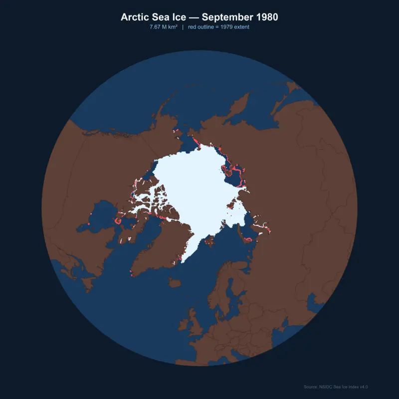
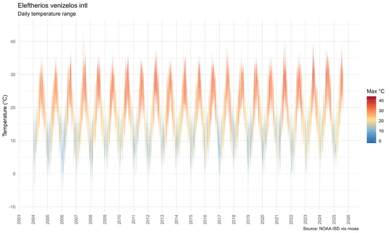
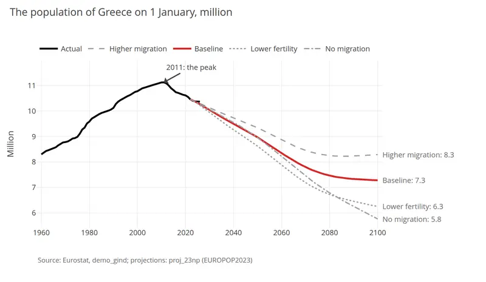
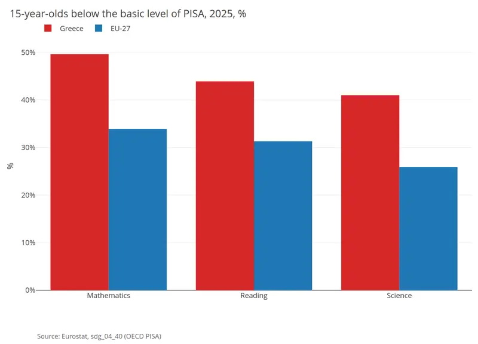
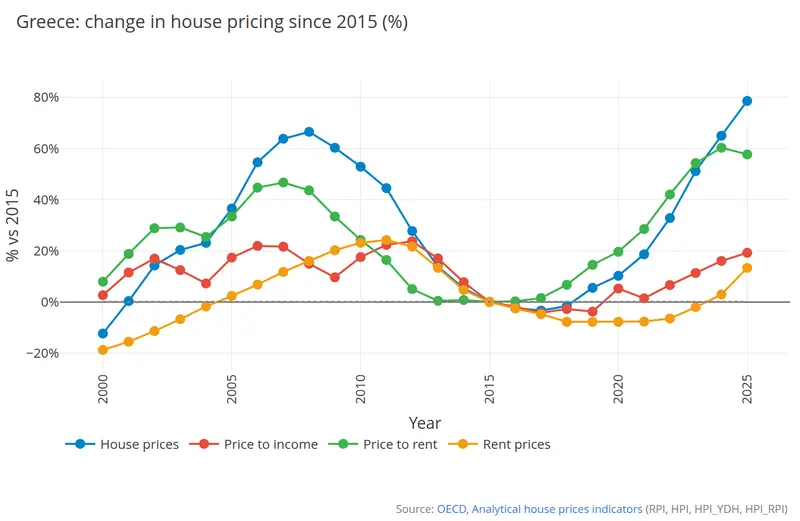
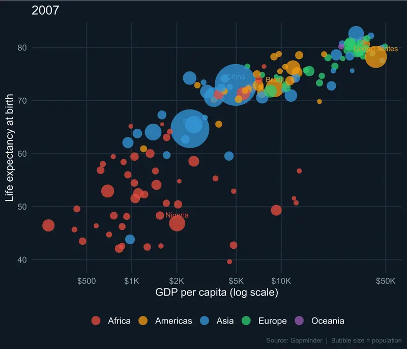
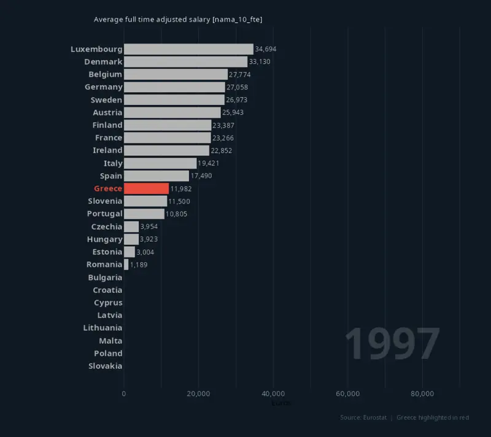

<!-- One card per page: a chart of the page (thumbnails/<page>.webp, drawn by
     ../_shared/thumbnails.R, which also says which chart), the title on the first line
     ([...]{.card-method}) and the subject on the second ([...]{.card-question}); the cards are
     styled in ../_shared/styles.scss. The navbar in _quarto.yml has the same groups, the same
     order and the same titles. -->

## Climate

::: {.index-cards}
- [{.card-image loading="lazy"}
  [Arctic Sea Ice Is Melting]{.card-method}
  [45 Years of Decline in NSIDC Data]{.card-question}](ILLUSTRATION_SEA_ICE.Rmd)
- [{.card-image loading="lazy"}
  [Climate Data Visualisation]{.card-method}
  [An Arctic Sea Ice GIF and a Climate Spiral]{.card-question}](ILLUSTRATION_SEA_ICE_TEMP.Rmd)
- [{.card-image loading="lazy"}
  [NASA GISS Global Temperature Anomaly]{.card-method}
  [Spider Plots, Time Series and a Heatmap]{.card-question}](ILLUSTRATION_CLIMATE_HIGHCHARTER.Rmd)
- [{.card-image loading="lazy"}
  [Airport Weather Analysis]{.card-method}
  [Temperature Ribbons and Heatmaps From NOAA ISD]{.card-question}](ILLUSTRATION_AIRPORT_WEATHER.Rmd)
:::

## Greece

::: {.index-cards}
- [{.card-image loading="lazy"}
  [Greece Since 2000]{.card-method}
  [Boom, Crisis and Recovery]{.card-question}](ILLUSTRATION_GREECE_SINCE_2000.Rmd)
- [{.card-image loading="lazy"}
  [Same Crisis, Different Endings]{.card-method}
  [Greece and the Euro Crisis Countries]{.card-question}](ILLUSTRATION_EURO_CRISIS.Rmd)
- [{.card-image loading="lazy"}
  [Greek Public Debt]{.card-method}
  [How Much, to Whom, and Can Greece Repay It?]{.card-question}](ILLUSTRATION_GREEK_DEBT.Rmd)
- [{.card-image loading="lazy"}
  [Fewer and Older]{.card-method}
  [Greece's Population, Its Economy and Its Debt]{.card-question}](ILLUSTRATION_GREEK_POPULATION.Rmd)
- [{.card-image loading="lazy"}
  [Greece at Work]{.card-method}
  [Education, Skills, Jobs and Crime Compared with the EU]{.card-question}](ILLUSTRATION_GREEK_WORKFORCE.Rmd)
- [{.card-image loading="lazy"}
  [What Greece Makes, Sells and Buys]{.card-method}
  [And Can It Feed Itself?]{.card-question}](ILLUSTRATION_GREEK_ECONOMY.Rmd)
- [{.card-image loading="lazy"}
  [Greece's Summer Economy]{.card-method}
  [Who Comes, When, Where and What They Spend]{.card-question}](ILLUSTRATION_GREEK_TOURISM.Rmd)
- [{.card-image loading="lazy"}
  [Is Greece a Good Place to Invest?]{.card-method}
  [Risk, Costs, the State and the Courts]{.card-question}](ILLUSTRATION_GREEK_INVESTMENT.Rmd)
- [{.card-image loading="lazy"}
  [Greek Housing Race]{.card-method}
  [Rents, House Prices and Affordability in Europe]{.card-question}](ILLUSTRATION_GREEK_HOUSING.Rmd)
- [{.card-image loading="lazy"}
  [Greek Wages Race]{.card-method}
  [Salaries, Consumer Prices and Real Wages in Europe]{.card-question}](ILLUSTRATION_GREEK_WAGES_PRICES.Rmd)
:::

## Europe and the world

::: {.index-cards}
- [{.card-image loading="lazy"}
  [Hans Rosling's Bubble Chart]{.card-method}
  [Life Expectancy Against Income, Animated]{.card-question}](ILLUSTRATION_GAPMINDER.Rmd)
- [{.card-image loading="lazy"}
  [The World Is Having Fewer Babies]{.card-method}
  [Fertility and Ageing Since 1960]{.card-question}](ILLUSTRATION_FERTILITY.Rmd)
- [{.card-image loading="lazy"}
  [EU Salary Race]{.card-method}
  [Average Full-Time Adjusted Wages]{.card-question}](ILLUSTRATION_EU_SALARY.rmd)
- [{.card-image loading="lazy"}
  [Fired for AI, Hired Back]{.card-method}
  [What Happens When Companies Replace Workers with AI]{.card-question}](ILLUSTRATION_AI_LAYOFFS.Rmd)
:::

## Graphics

::: {.index-cards}
- [{.card-image loading="lazy"}
  [R Colors]{.card-method}
  [Names, RGB/HSV, and Building a Color Chart]{.card-question}](ILLUSTRATION_COLOR_CHART.Rmd)
- [{.card-image loading="lazy"}
  [Illusions in R]{.card-method}
  [Café Wall, Hermann Grid, Ouchi, Rotating Snakes and More]{.card-question}](ILLUSTRATION_ILLUSIONS.rmd)
:::
